## A Utilitarian Appliance.

I once fried a motherboard back in 2021 after plugging it into an old hotel room outlet; I learned a couple of things from that experience, one of which being to always plug in my charging cord and see what happens before connecting my laptop. As traumatic as that experience was, it led to me purchasing my current HP Omen 15 (15-EN0023DX) because it had decent specs and I could complete software projects on it without issue… not to mention a video game or two.

It’s been about 5 years since then and I have literally spent my whole entire tech career on this machine. It has seen my growth from learning what Linux is to dual-booting into NixOS, and adding various customizations. It’s hard not to become pretty attached to a machine after growing and learning so much. However, in the back of my mind I always knew there was a ticking time bomb of some sort (and hopefully not hotel-electro-pocalypse 2 lol).

Before I became serious about I.T., like most folks, I experienced my share of irreparably damaged machines. Components go, things short, capacitors rust, HP is not necessarily known for its longevity 😂, and generally I figured something would get me “sooner rather than later”. I came into the field around my late 20s/early 30s; and if I have learned anything, exposure and discovery can make a world of difference in how you interact with the world around you. As a child, I was deathly afraid of damaging expensive devices we had in our home, and so “tinkering” wasn’t even a figment of my imagination or a part of my lexicon. That paired with my high school’s “Computer” class being an intro to Word course where we knew more than the business teacher, I was truly a statistic of my environment at the time. Therefore, things like DIY, robotics, and makers projects were not on my radar. To give myself some credit, every now and again I felt safe enough manipulating source code on the cd-rom video games we would buy in Walmart's electronics aisle to create/activate cheats, but my interest was still fairly nascent at that point.

As I've grown and learned more about electronics, DIY, iFixit, and Maker communities have become increasingly more appealing to me. I even bought a Raspberry Pi before they were no longer accessible, which feels so weird to type. These interests inspired me to begin listening to podcasts where the hosts sometimes opined about the Right to Repair and planned obsolescence. This growing exposure has naturally heightened my “spidey senses” around general electronic issues which brought me to the reason this article exists.

## What's that Whirring Noise?

One day I realized the fans on my laptop spinning profusely was not normal, especially as it was sitting idle, and it dawned on me that I should probably take a look into why that was happening 😅. A few Googlefu sessions later I realized that my 5 year old HP Omen 15 _might_ have dried caked up thermal paste that was no longer functional. Most of my EOL experiences with machines whether they were desktops or laptops were usually catastrophic failures like the aforementioned motherboard being fried by a poorly wired hotel outlet, or closing an old Macbook and thinking it was safe in sleep mode in my college backpack. Previously, I kind of had an average consumer mindset that computers just didn’t “last,” and that I should simply brace myself for another eventual expensive purchase.

We all know companies love planned obsolescence and nobody talks about the maintenance tasks that are needed if you want to get the most life out of your laptop or PC. For me, as mentioned earlier; the lack of routine cleaning and reapplication of thermal paste or thermal sheets (if you are fancy and can source legit material), ended up being a main contributor to excessive heating of the CPU and GPU dies. Through internet sleuthing I discovered an [iFixit guide](https://www.ifixit.com/Guide/HP+OMEN++15-dc0030nr+Thermal+Paste+Replacement/112630) of a laptop similar to my own and numerous youtube videos which inspired me to complete this common DIY task.

## Safety First.

Given my trauma around fried motherboards the first thing I did was pick up an [Antistatic Wrist Strap](https://www.bestbuy.com/product/ifixit-antistatic-wrist-strap/J38JT99F8G) to complete this work. You have to make sure the metal plate inside the bracelet makes contact with your skin and the metal clip is securely attached to a metal frame that is grounded ([iFixit’s guide](https://www.ifixit.com/Guide/How+to+Use+the+Anti-Static+Wrist+Strap/153022)).

<div class="image-row">

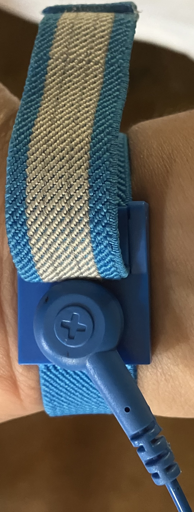 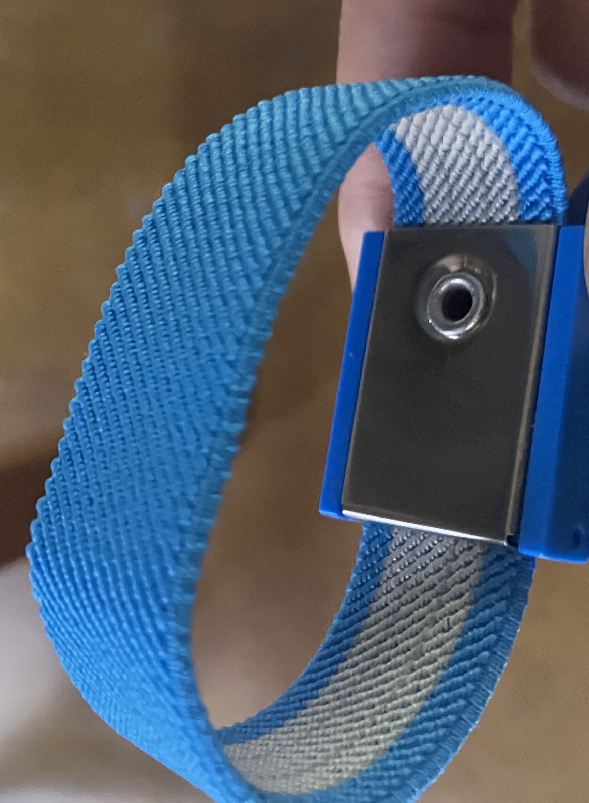

</div>

## The Chassis.

The screws that needed to be removed in order to access the motherboard were quite tedious. However, after some persistence I eventually got them loose. I later would learn most things being disconnected or removed would also be an exercise in patience.

- Outer screws

  There were 8 screws holding the bottom chassis plate in place. However,
  prying it open was another ordeal entirely.

- Prying sides open

  You have to either use a guitar pick or "I.T." tool pick like the one I used
  in the image below to avoid breaking the clamps which keep the chassis in place
  without screws.

<div class="image-row">

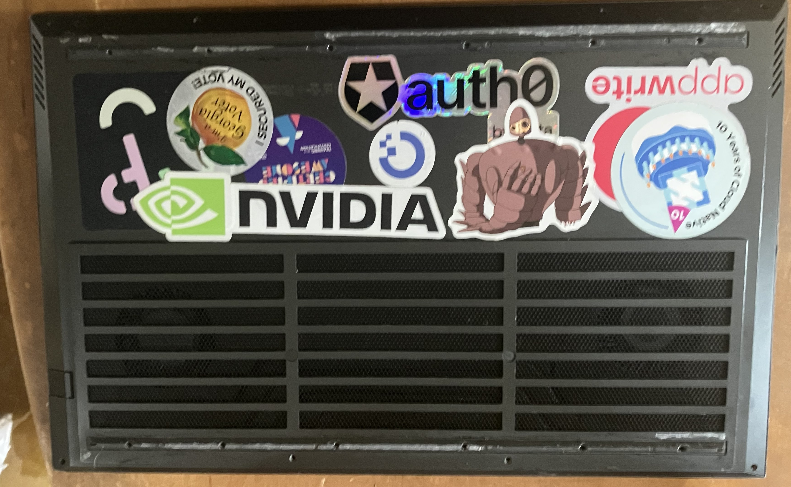 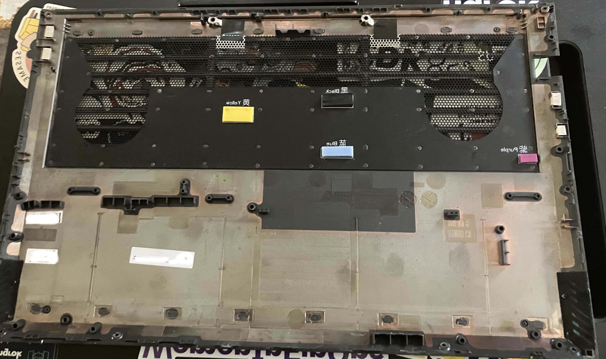 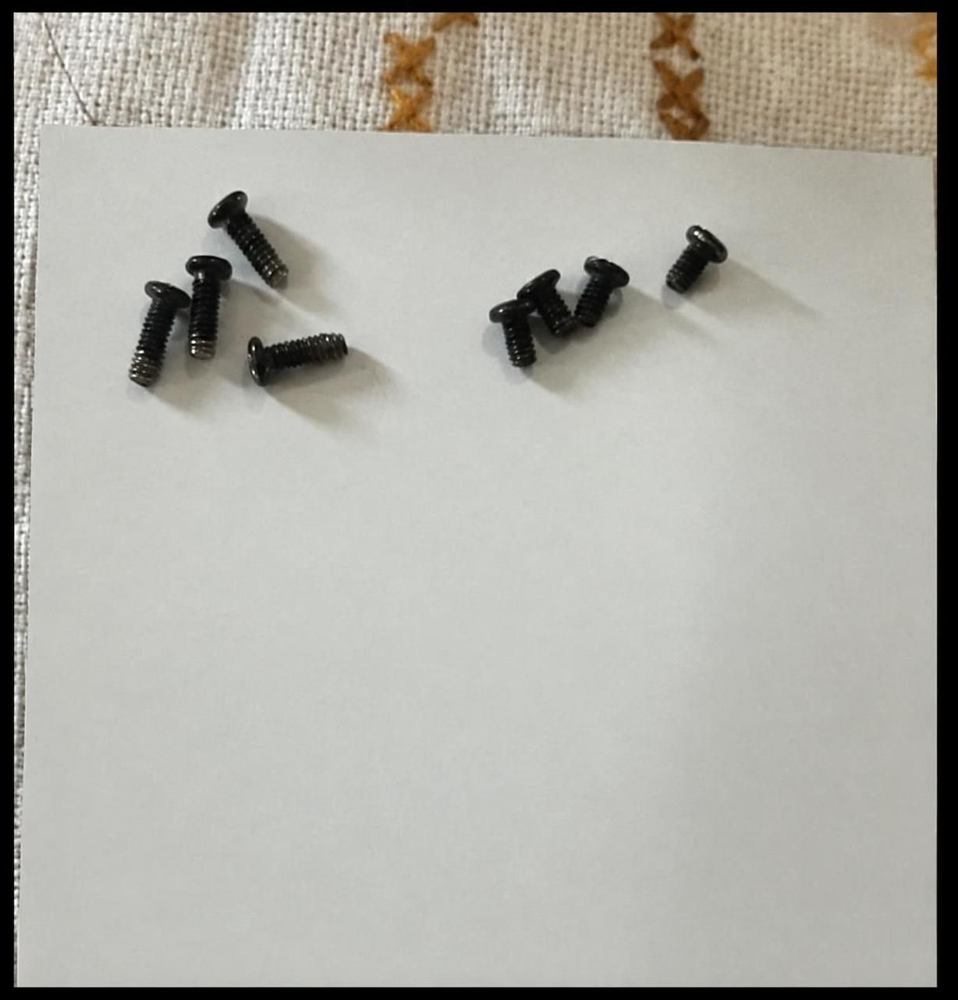 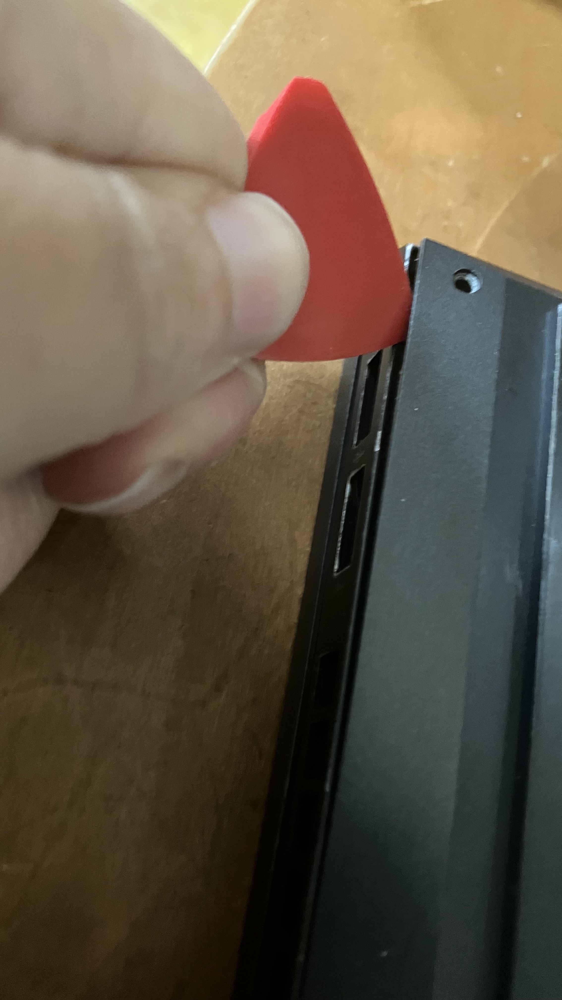

</div>

## The Dangers of Power.

It is important to first unplug the charger and disconnect the battery before beginning any real work. It was crazy difficult to detach and I had to unscrew part of the battery and then uncomfortably wedge the connector from both sides alternating pulls; at one point I wasn’t sure if it was going to give but eventually it did and the battery wires thankfully stayed intact.

<div class="image-row">

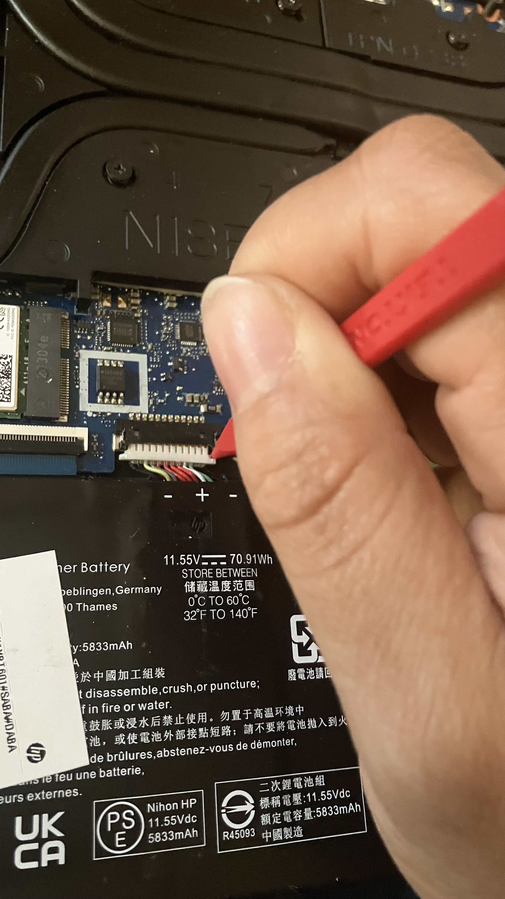

</div>

I then held the power button for 20 seconds in an attempt to discharge residual "[flea power](https://www.dell.com/support/manuals/en-us/xps-15-7590-laptop/xps-15-7590-service-manual/drain-residual-flea-power-perform-hard-reset?guid=guid-2da79962-34ff-421b-8b91-39cbbb623ca0&lang=en-us)"
which could potentially damage sensitive components.


<div class="image-row">

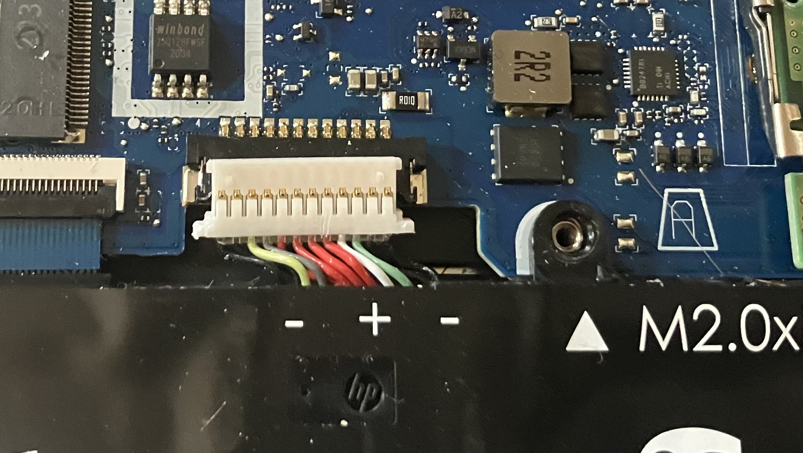

</div>

## Accessing the Dies.

To expose the CPU and GPU dies you must remove the screws in the numbered alternate pattern doing a few turns at a time to not disturb the balanced pressure with which the heatsink and thermal pads are placed against the various components. This also goes for reapplication in reverse, to get an even spread on the thermal paste, and so that you have adequate cooling. The general rule of thumb on the internet seems to be "loosen in reverse, tighten in order".

Without going into too much detail 5 years of debris is fairly gnarly… let’s just say 91% isopropyl alcohol, a tooth brush head, and q-tips went a long way in cleaning up my poorly neglected machine.


<div class="image-row">

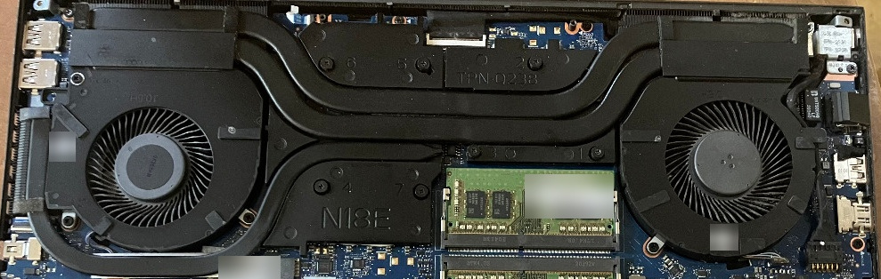

</div>

## X Marks the Chip.

For this machine I went with [Arctic’s MX-7 thermal paste](https://www.arctic.de/us/MX-7/ACTCP00089A) and am fairly impressed; I have absolutely no complaints and am pleased at how performant things are under stress with tools like stress-ng and how quickly things cool after the fans engage with the new paste job.


<div class="image-row">

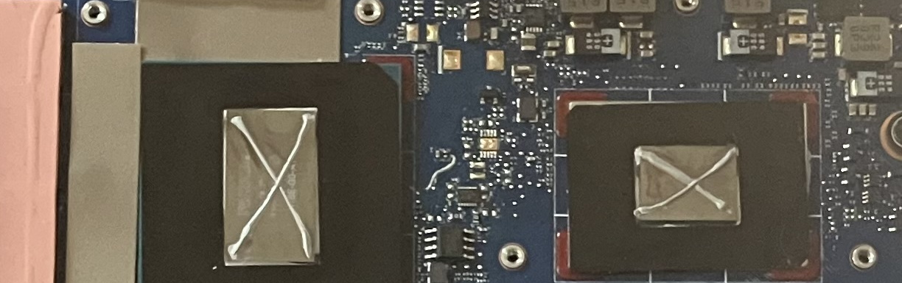 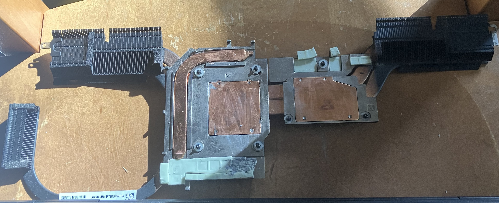

</div>

## Quiet Again.

This was admittedly my second application; I repasted it because I wanted to
document the process and capture images... my first paste job was cleaner; I did
end up doing a little bit of cleaning after capturing the picture of the dies.

Before the repaste job the temperatures for the CPU and GPU were averaging at
the higher end of the 60–95+ °C spectrum, and quite honestly not cooling down
efficiently at all when the fans were engaged. Now after a stress-ng run, temps
dip back to around 40 °C almost instantly with the fans engaged.

```shell
# Ran these commands and then watched the temps to see how things recovered
nix-shell -p stress-ng --run "stress-ng --cpu 0 --timeout 90s"
nix-shell -p stress-ng --run "stress-ng --gpu 1 --oom-avoid --timeout 90s"
```

With a little bit of DIY elbow grease; laptops can last a bit of time, but with
everything there is always the calculus of time, effort, and replacement costs.

The paste was $7 so not even really a drop in the bucket, and I'm sure if I had
taken it into the shop I would have been asked to pay some multiple of $7 to
have a similar outcome. At the end of the day; I feel it was a fun thing to do
on my birthday and I happened to save money in the process too!
